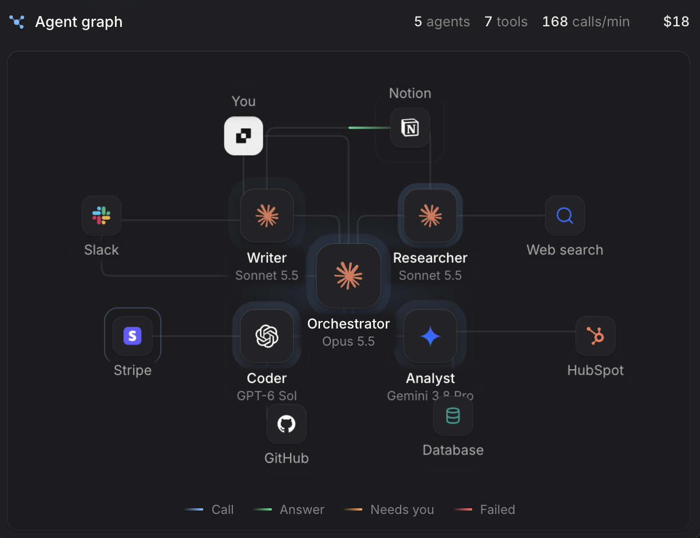
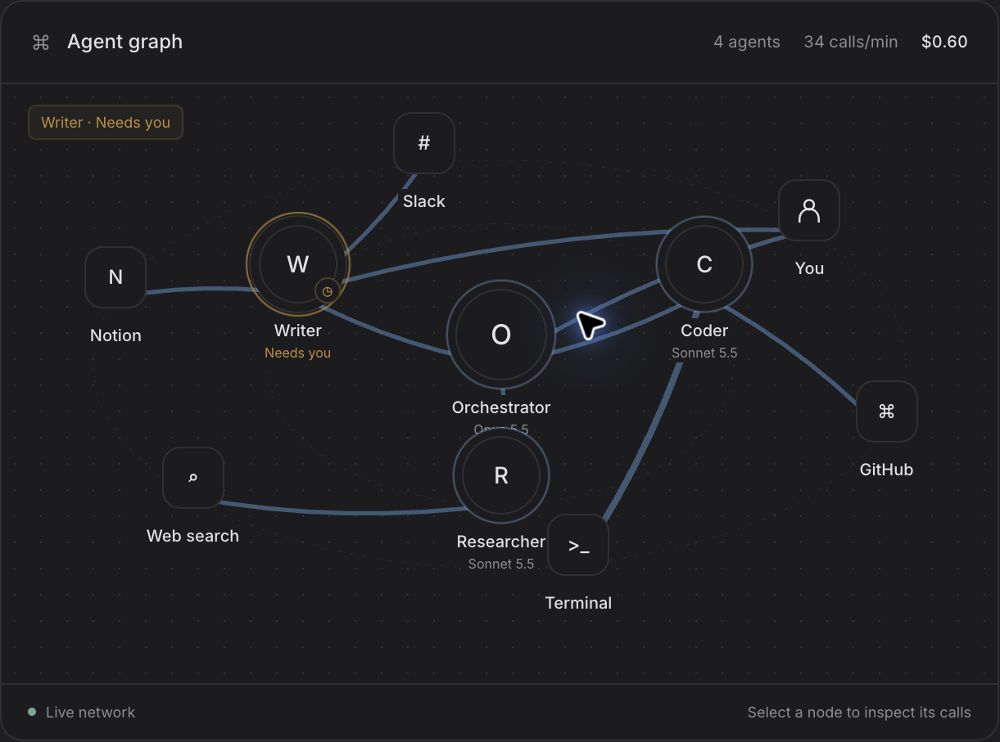

# Agent Graph: screenshot-based correction

The user supplied both screenshots below. The local screenshot is **before** the latest correction; it is retained as evidence of the discrepancy, not as the final result.

| Observed discrepancy                         | Change in the current source                                                                                                       |
| -------------------------------------------- | ---------------------------------------------------------------------------------------------------------------------------------- |
| Circular letter avatars                      | Rounded-square node tiles, with embedded Claude, OpenAI, Gemini and tool SVG logos                                                 |
| 4 agents and different tools                 | Reference demo with Orchestrator, Writer, Researcher, Coder, Analyst; seven tools and You                                          |
| Different positions and label placement      | Reference-relative normalized positions; labels above the two top nodes; general graph still lays out arbitrary data automatically |
| Sweeping curved links                        | Horizontal/vertical connector segments with short rounded corners                                                                  |
| Strong blue links and dot-grid background    | Quiet neutral connectors and a flat canvas; blue/green/orange/red travelling call segments                                         |
| Header inside a bordered card, no tool count | Separate compact header with network icon, agents, tools, calls/min and summed cost                                                |
| “Live network” footer                        | Call / Answer / Needs you / Failed legend                                                                                          |
| Selecting a node invented extra calls        | Counts derive only from supplied call records                                                                                      |

The current file also handles selection dialogs, keyboard focus, missing nodes, call heat, reduced motion and offscreen/hidden animation pausing. API/state tests do not certify its visual appearance.

**Verification still required:** a screenshot of the revised local render, paired at the same width/theme/time with the reference. Current browser permissions block this capture. No pixel-identical claim is made. These supplied screenshots only establish the reference state shown; they do not establish all animation, popup or mobile states.

## User-supplied reference

## User-supplied local render before correction

